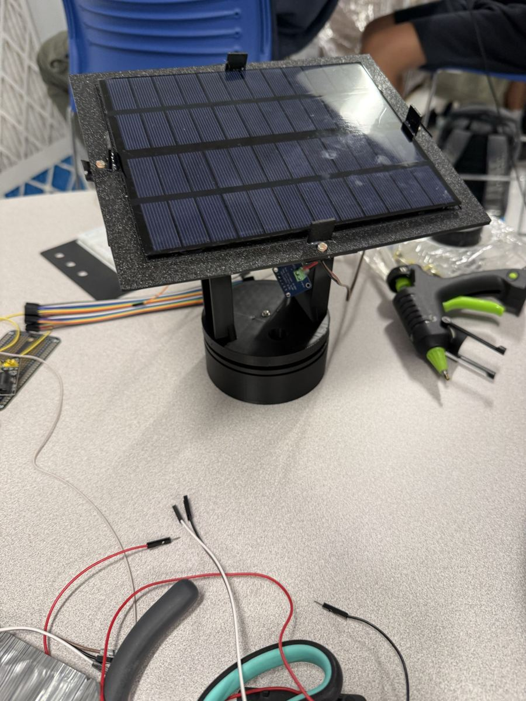
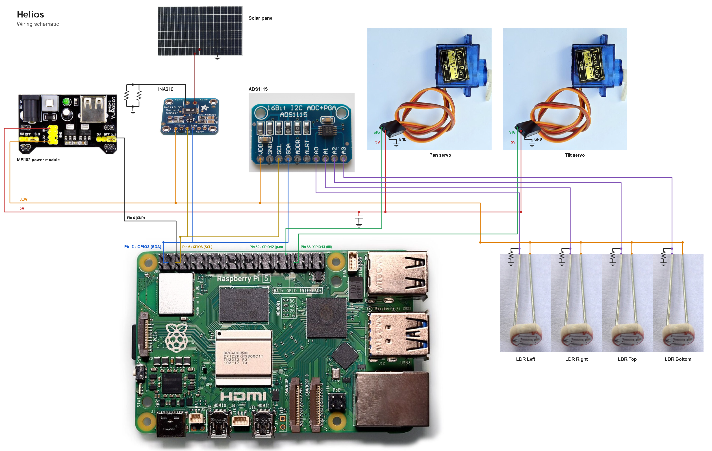

# Helios

**A small solar panel that follows the light.** Built for hackPHS 2026, theme "Into the Skies".

[Live dashboard](https://helios-hackphs.vercel.app/) | [Devpost](https://devpost.com/software/solar-benders) | [Demo video](https://youtu.be/VfBEgQn8bzc)



## The idea

A fixed balcony panel only faces the sun for part of the day. Helios tilts and turns a panel toward the brightest light, so the same panel makes more power from the same sky. It runs on a Raspberry Pi 5, costs a few dollars in sensors, and streams everything it measures to a live web dashboard.

## How it works

1. **Sense.** Four light sensors (LDRs) sit at the edges of the panel, read by an ADS1115 ADC.
2. **Steer.** The Pi compares left vs right and top vs bottom, then drives two hobby servos (pan and tilt) toward the brighter side until the four readings even out.
3. **Measure.** An INA219 reads the panel's voltage, current and power, so we can compare tracking against a fixed panel.
4. **Show.** The Pi logs locally and pushes readings to a Vercel + Neon dashboard.

At night the mount returns home. An A/B test mode runs 10 s fixed, then 10 s tracking, to show the gain.



## Efficiency

| Setup | Parasitic load | Daily cost | Panel needed to break even |
|---|---|---|---|
| Servos only, PWM detached | tiny | ~0.03 Wh | under 1 W |
| Servos, PWM held all day | ~0.1 W | ~1 Wh | ~1 W |
| Servos plus Pi 5, always on | ~3 W | ~72 Wh | ~80 W at +18%, ~48 W at +30% |
| Servos plus ESP32 or Pico class | ~0.3 W | ~7 Wh | ~8 W at +18%, ~5 W at +30% |

- **This build:** the 3.6 W panel makes about 18 Wh/day, so +18% is about 3.2 Wh. The servos barely matter. The Pi uses about four times the panel's whole output, so with a Pi this is a net loss. A microcontroller, or a Pi that sleeps between moves, fixes that.
- **Solar farm:** single-axis trackers gain about 15 to 25% in sunny regions (5 to 10% where it is cloudy) and spend about 1% or less of their output on moving. In large scale solar farms, the cost of this pays off
- **Rooftop:** a 400 W panel gains about 0.35 kWh/day net, which is slightly more than the energy use to run this system, so the system is beneficial but isn't a large difference.
- **Torque:** the MG90S gives about 2 kg-cm. A larger panel needs a gearmotor, linear actuator or slew drive.

## Dashboard

Live at **https://helios-hackphs.vercel.app/**. It shows pan and tilt, the four LDR levels, panel voltage, current and power, history charts, the A/B result, and CSV export. The page shows OFFLINE after 5 seconds without data. Lux, temperature and humidity have no sensor in this build and show n/a.

The sample history shown before live data arrives is reconstructed from value ranges observed during the build. It is not a raw recording.

## Hardware

| Part | Job |
|---|---|
| Raspberry Pi 5 | Runs the control loop |
| 12 V 3.6 W panel (178 x 142 mm) | The thing being aimed |
| 2 x MG90S servos | Pan and tilt |
| 4 x GL5528 LDRs | Direction sensing |
| ADS1115 | Reads the LDRs |
| INA219 | Measures panel power |
| SSD1306 OLED | Local readout |
| MB102 breadboard supply | Separate 5 V rail for the servos |

## Wiring

| Function | Pin / address |
|---|---|
| Pan servo signal | GPIO 12 (hardware PWM) |
| Tilt servo signal | GPIO 13 (hardware PWM) |
| I2C | SDA GPIO 2, SCL GPIO 3 |
| INA219 | 0x40 |
| ADS1115 | 0x48 (ADDR to ground) |
| OLED | 0x3C |

- Servo power comes from the MB102 5 V rail, never from the Pi. Join its ground to a Pi GND pin.
- Each LDR is a divider: 3.3 V, LDR, ADS1115 input, 10k to ground.
- Software limits: pan +/-80 degrees, tilt 15 to 85 degrees. Tuning lives in `pi/config.json`.

Full schematic: `web/public/img/schematic.png`.

## Run it

### Pi

One-time setup:

```bash
sudo raspi-config        # Interface Options -> I2C -> Enable
# add to /boot/firmware/config.txt, then reboot:
dtoverlay=pwm-2chan,pin=12,func=4,pin2=13,func2=4
i2cdetect -y 1           # expect 0x40, 0x48, 0x3C
```

Install and start:

```bash
cd pi
python3 -m venv .venv && source .venv/bin/activate
pip install -r requirements.txt
python tracker.py        # add --no-servo to test sensors and OLED only
```

In a second SSH session, push readings to the dashboard:

```bash
python sender.py
```

Copy `pi/.env.example` to `pi/.env` and set `MT_API_URL` and `MT_SHARED_SECRET`. The sender survives Wi-Fi drops and sends the backlog when the link returns.

Keys in the tracker terminal: `a` arm servos, `t` toggle track/fixed, `j`/`l` pan, `i`/`k` tilt, `x` A/B test, `c` calibrate, `q` quit.

### Dashboard

```bash
cd web
npm install
npm run migrate          # create tables in Neon
npm run seed:dry         # preview sample history, then: npm run seed
npm test                 # logic checks
vercel --prod
```

Set `DATABASE_URL` (Neon) and `INGEST_SECRET` in Vercel and in `web/.env` (see `web/.env.example`). API routes: `/api/ingest` (POST, secret required), `/api/latest`, `/api/replay`, `/api/energy-history`, `/api/ab`, `/api/export`.

## Repo layout

- `pi/` - sensing, control, logging and the sender, plus the local `energy_history.db`
- `web/` - everything for the dashboard
  - `public/` - the deployed site (`index.html`, `build.html`, `site.css`, `img/`)
  - `api/` - Vercel API routes
  - `scripts/` - Neon schema, migration and seed
  - `app.py`, `index.html`, `helios_logo.png` - the local Flask dashboard that reads `pi/energy_history.db`
- `pics/` - build photos
- `.gitignore` - covers the whole repo

## Credits

- Solar panel photo: "Photovoltaic Solar Panel.jpg" by AcornToOak, Wikimedia Commons, CC BY-SA 4.0 (https://creativecommons.org/licenses/by-sa/4.0). Cropped and straightened.
- Photoresistor photo: "LDR07 Light-dependent CdS photoresistor.jpg" by BenTheWikiMan, Wikimedia Commons, public domain. Cropped.
